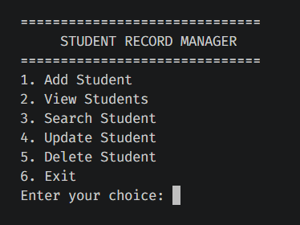
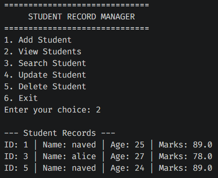
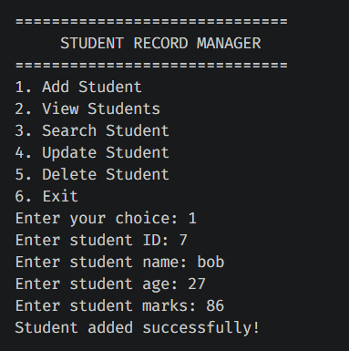
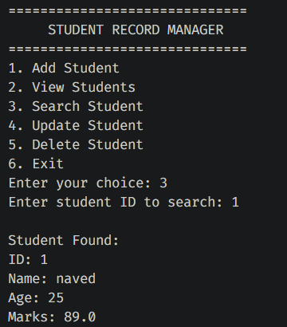
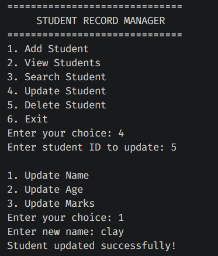
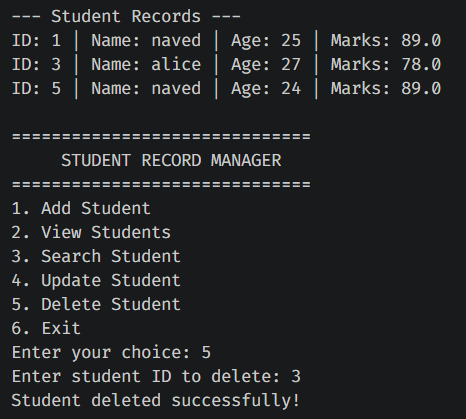

# Student Record Manager

A simple **Student Record Management System** built with **Python** and **JSON** file handling.

This is a menu-driven console application that allows users to add, view, search, update, and delete student records. Student data is stored permanently in a `students.json` file.

## 🚀 Features

* ➕ Add a new student
* 📋 View all students
* 🔍 Search for a student
* ✏️ Update student information
* 🗑️ Delete a student
* 💾 Store student records in a JSON file
* 🖥️ Simple menu-driven terminal interface
* 🔄 Data remains available after restarting the program

## 📸 Screenshots

### Main Menu



### Student Records



### Add Student



### Search Student



### Update Student



### Delete Student



## 🛠️ Technologies Used

* **Python 3**
* **JSON**
* File Handling
* Functions
* Lists and Dictionaries
* Exception Handling
* Conditional Statements and Loops

## 📂 Project Structure

```text
Student-Record-Manager/
│
├── main.py
├── students.json
└── README.md
```

### Files

* `main.py` — Contains the main program logic and menu system.
* `students.json` — Stores student records.
* `README.md` — Project documentation.

## ▶️ How to Run

### 1. Clone the repository

```bash
git clone https://github.com/naved2001/student-record-manager
```

### 2. Open the project folder

```bash
cd Student-Record-Manager
```

### 3. Run the program

```bash
python main.py
```

If your system uses `python3`, run:

```bash
python3 main.py
```

## 📋 Menu

When the program starts, you can choose from the following options:

```text
===== Student Record Manager =====

1. Add Student
2. View Students
3. Search Student
4. Update Student
5. Delete Student
6. Exit
```

## 💾 Data Storage

Student information is stored in the `students.json` file.

Example:

```json
[
    {
        "id": 1,
        "name": "John",
        "age": 20,
        "course": "Computer Science"
    }
]
```

The program reads the JSON file when required and updates it whenever student records are added, updated, or deleted.

## 🧠 Concepts Practiced

This project helped me practice:

* Python functions
* Lists and dictionaries
* `if/elif/else` conditions
* `for` and `while` loops
* User input
* File handling
* JSON serialization and deserialization
* CRUD operations
* Exception handling
* Building a menu-driven application

## 🔮 Future Improvements

Possible improvements for future versions:

* Add a graphical user interface
* Add student sorting and filtering
* Add more detailed student information
* Add validation for user input
* Replace JSON storage with a database such as SQLite or MySQL
* Add authentication for administrators

## 📌 Project Purpose

This project was created as a **Python practice project** to understand how file handling, JSON data storage, functions, and CRUD operations can be combined to build a useful console-based application.


⭐ If you found this project useful, feel free to star the repository.
